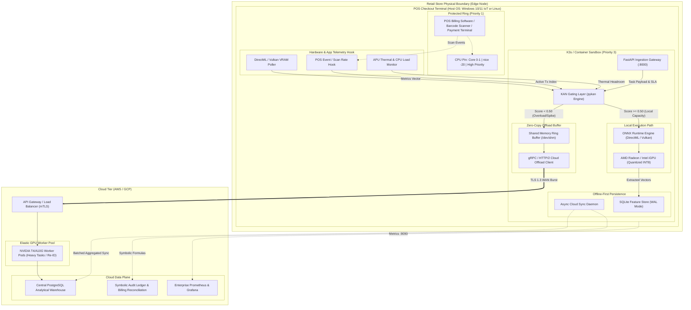
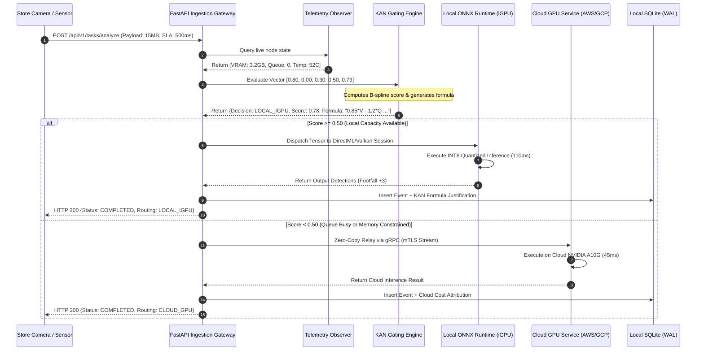
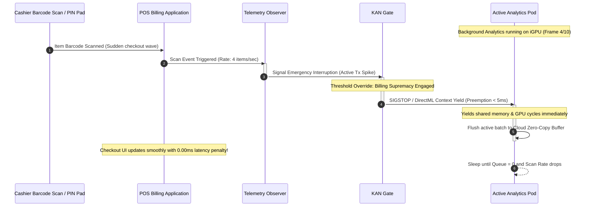

# System Architecture & Technical Design Document
## Project: KAN-Edge POS Analytics (Edge-Optimized POS Analytics)
**Document Version:** 1.0.0  
**Status:** Approved Architecture  

---

## 1. Architectural Topology

The KAN-Edge architecture operates across two physical tiers:
1. **The Edge Tier:** Existing Point-of-Sale (POS) checkout terminals acting as localized edge compute nodes equipped with integrated GPUs (AMD Ryzen / Radeon or Intel Iris Xe APUs).
2. **The Cloud Tier:** An elastic cluster in AWS or GCP hosting auto-scaling GPU workers (NVIDIA T4 / A10G) and a central analytical database (PostgreSQL).



---

## 2. Component Breakdown & Boundaries

### 2.1 The Mission-Critical Billing Ring
* **Boundary:** Hardware-enforced process segregation.
* **Responsibilities:** Barcode scanning, item lookup, subtotal calculation, credit card authorization (PCI-DSS scoped), receipt printing.
* **Operating Profile:** Absolute top priority in CPU scheduling, memory reservation, and bus access.
* **Zero Contamination:** The analytics environment has **no network access, file access, or socket visibility** into the billing software's Cardholder Data Environment (CDE).

### 2.2 Telemetry Observer Daemon
* **Implementation:** A low-overhead C++/Python native background service polling every $100\text{ms}$ with $< 0.1\%$ CPU overhead.
* **Metrics Tracked:**
  * Active transaction state (scans in progress, card terminal busy).
  * Video RAM allocation (DirectX DXGI adapter memory query on Windows, sysfs DRM memory counters on Linux).
  * APU die temperature and hardware thermal throttling flags.

### 2.3 KAN Gating Engine (`pykan`)
* **Role:** Intelligent, interpretable load balancer and admission controller.
* **Evaluation Time:** $< 3.5\text{ms}$ on CPU.
* **Operation:** Evaluates the continuous multi-dimensional surface mapped by learnable B-splines. Converts non-linear relationships (e.g., thermal throttling compound penalties combined with high queue length) into an exact scalar score and an algebraic string justification.

### 2.4 Local ONNX Runtime Inference Worker
* **Backend:** ONNX Runtime with DirectML (`DmlExecutionProvider`) on Windows or Vulkan on Linux.
* **Models:** INT8-quantized YOLOv8-nano and MobileNetV4.
* **Thread Budget:** Clamped to 2 worker threads pinned to non-critical CPU cores.
* **Shared Memory Usage:** Limits tensor allocation to $\le 60\%$ of total shared VRAM.

### 2.5 Zero-Copy Cloud Egress Buffer
* **Mechanism:** When a task is marked for cloud fallback, memory is not re-copied across user space. A pointer reference into shared memory (`/dev/shm`) is passed directly to the asynchronous gRPC streaming client.
* **Compression:** Fast Snappy/LZ4 compression before network socket write.

### 2.6 Distributed Data Layer (SQLite $\to$ PostgreSQL)
* **Local Database:** SQLite 3 in WAL mode. Capable of $> 15,000$ sequential inserts/sec with zero impact on system responsiveness.
* **Durability:** Survives physical power disconnects, sudden POS terminal reboots, and multi-day store internet blackouts.
* **Sync Engine:** Asynchronous worker uploading batches of extracted features (footfall counts, dwell durations) to central PostgreSQL in AWS/GCP.

---

## 3. Sequence Diagrams

### 3.1 Task Ingestion & Dynamic KAN Routing Sequence



---

### 3.2 "Billing Always Wins" Preemption & Throttling Sequence



---

## 4. State Machine: POS Priority & Dynamic Throttling

```mermaid
stateDiagram-v2
    [*] --> IdleState : Node Boot

    state IdleState {
        description: POS terminal inactive, register idle.
        VRAM: 85% Free
        CPU: < 15%
    }
    
    state EdgeInferenceActive {
        description: Local ONNX executing on AMD Radeon / Intel iGPU.
        VRAM: 45% Free
        CPU: ~40%
    }

    state CloudOffloadState {
        description: Local capacity saturated; tasks relay to cloud GPU.
        VRAM: Preserved
        Bandwidth: Active gRPC stream
    }

    state EmergencyPreemption {
        description: BILLING ALWAYS WINS! Hard interruption.
        Actions: Freeze analytics, yield GPU, drop/offload frames.
    }

    state OfflineDegraded {
        description: Internet WAN connection lost.
        Actions: Local opportunistic inference only; write to SQLite WAL.
    }

    IdleState --> EdgeInferenceActive : Analytics Task Arrives (KAN Score >= 0.50)
    IdleState --> CloudOffloadState : Analytics Task Arrives (KAN Score < 0.50)
    
    EdgeInferenceActive --> IdleState : Task Completed
    EdgeInferenceActive --> EmergencyPreemption : Cashier Scan Detected (Queue > 0)
    
    CloudOffloadState --> IdleState : Task Stream Complete
    
    EmergencyPreemption --> IdleState : Checkout Wave Cleared (Queue == 0 for 5s)
    
    EdgeInferenceActive --> OfflineDegraded : Network Down
    CloudOffloadState --> OfflineDegraded : Network Down & Fallback Blocked
    OfflineDegraded --> IdleState : Network Restored & Synced
```

---

## 5. Network Topology & Port Mapping

```
+----------------------------------------------------------------------------------------------------+
|                                    FIREWALL & PORT MATRIX                                          |
+---------------------+-------------------+----------+-----------+-----------------------------------+
| COMPONENT           | IP / INTERFACE    | PORT     | PROTOCOL  | PURPOSE                           |
+---------------------+-------------------+----------+-----------+-----------------------------------+
| POS Billing App     | Isolated CDE VLAN | 443/8443 | HTTPS/TLS | Bank acquirer & POS Cloud backend |
| KAN FastAPI Gateway | 127.0.0.1 (Loop)  | 8000     | HTTP/JSON | Ingestion of camera frame tasks   |
| Prometheus Exporter | 127.0.0.1 (Loop)  | 9090     | HTTP      | Node & KAN telemetry scraping     |
| Cloud Egress gRPC   | WAN Interface     | 443/50051| gRPC/mTLS | Fallback stream to Cloud GPU      |
| PostgreSQL Sync     | WAN Interface     | 5432     | TCP/TLS   | Asynchronous feature replication  |
+---------------------+-------------------+----------+-----------+-----------------------------------+
```

---

## 6. Failure Modes & Self-Healing Matrix

| Failure Mode | Detection Indicator | Automated Self-Healing Action | Impact on Billing |
| :--- | :--- | :--- | :--- |
| **Out of Memory (OOM) Danger** | Total system free RAM $< 1.2\text{GB}$ | OS OOM Killer targets Analytics Pod (`oom_score_adj = +800`). Analytics dies; POS Billing (`oom_score_adj = -1000`) untouched. | **Zero Impact** |
| **iGPU Driver Hang / Timeout (TDR)** | DirectX TDR event or Vulkan `VK_ERROR_DEVICE_LOST` | ONNX session restarts with CPU fallback; KAN gate automatically routes all subsequent tasks to Cloud until APU reset. | **Zero Impact** |
| **WAN Internet Outage** | gRPC fallback connection timeout $> 2000\text{ms}$ | Circuit breaker flips. High-priority tasks execute locally during cashier idle gaps; features buffer in SQLite. | **Zero Impact** |
| **Heavy Video Burst Overload** | Task arrival rate $> 30\text{fps}$ | Fast token bucket rate limiter in FastAPI drops lowest-priority frames at edge; queues bounded to 5 frames max. | **Zero Impact** |
| **Local SQLite Corruption** | SQLite I/O error or checksum failure | System rolls forward using WAL checkpoint; rebuilds empty DB schema if necessary; cloud already holds historical records. | **Zero Impact** |

